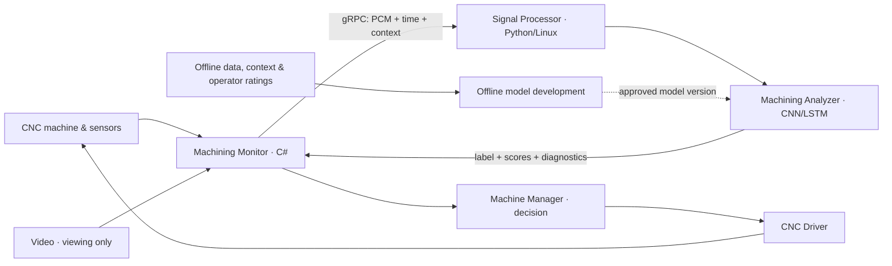

# MA Monitor → Machining Analysis：接口研究与协议草案

## Entrada principal: RTSP en tiempo real

La fuente de audio en tiempo real es RTSP, no gRPC. La configuración está en
`.env` y apunta por defecto a:

```text
rtsp://localhost:18554/audio
```

Ejecutar el receptor RTSP y el clasificador:

```powershell
& .venv\Scripts\python.exe Integration\rtsp_stream_service.py
```

FFmpeg lee el RTSP, decodifica y convierte a PCM16LE estéreo de 44.1 kHz.
Después `StreamingClassifier` acumula ventanas completas de cinco segundos y
escribe las predicciones en `runs/rtsp/live_predictions.jsonl`. Una cola o
ventana incompleta se informa como tail y no se clasifica.

## Integración opcional: gRPC unary

La primera implementación ejecutable está en `grpc_service.py`. Mantiene un
checkpoint cargado en memoria y expone `ModelInfo` y `AnalyzeSegment`. El
endpoint se enlaza a `127.0.0.1` por defecto, para no publicar un servicio sin
TLS accidentalmente. `AnalyzeStream` sigue reservado para la segunda fase.

Instalar las dependencias en el entorno del proyecto:

```powershell
& .venv\Scripts\python.exe -m pip install -r requirements.txt
```

Arrancar el servicio con un checkpoint de clasificación:

```powershell
& .venv\Scripts\python.exe Integration\grpc_service.py `
  --model cnn `
  --checkpoint runs\train\<timestamp>\classification\cnn\best.pt `
  --device cpu `
  --host 127.0.0.1 `
  --port 50051
```

También puede arrancarse usando los valores de `.env` del proyecto:

```powershell
& .venv\Scripts\python.exe Integration\grpc_service.py
```

Los argumentos CLI tienen prioridad sobre `.env`. Las variables disponibles
son `MACHINING_GRPC_HOST`, `MACHINING_GRPC_PORT`, `MACHINING_GRPC_MODEL`,
`MACHINING_GRPC_CHECKPOINT`, `MACHINING_GRPC_DEVICE` y
`MACHINING_GRPC_THREADS`.

En otra terminal, probar la conexión y una ventana completa de 5 segundos:

```powershell
& .venv\Scripts\python.exe Integration\grpc_client_smoke.py `
  --endpoint 127.0.0.1:50051 `
  --wav Dataset\Data\20261012_124615\audio_000000.wav
```

El contrato actual exige PCM16LE estéreo intercalado, 44.1 kHz y exactamente
220500 frames por solicitud. La respuesta es orientativa: la confianza es un
softmax no calibrado y no autoriza acciones sobre la máquina.

核对日期：2026-11-11。配套文件：[machining_analysis_v1.proto](proto/machining_analysis_v1.proto)。

**这是一份待双方讨论的接口提案，不是公司已确认的协议，也不是已经接入 MA 的服务。** 本次工作没有启动网络服务器、发送公司消息或执行机床控制。

## 现在可以运行的本地调用演示

现在可以统一从 `main.py` 选择训练或推理。推理复用 `simulate_monitor.py`，用真实权重和WAV，在同一个Python进程内模拟Monitor发送方与AI服务方，传递解码后的PCM16LE字节并返回标签和分数。它不会建立gRPC连接或运行C#客户端。

```bash
python main.py --mode train --task classification --model cnn --csv Dataset/Processed_5s/samples.csv --epochs 200
python main.py --mode infer --input-mode file --model cnn --device auto --checkpoint /path/to/best.pt --wav /path/to/recording.wav
python main.py --mode infer --input-mode stream --model cnn --device auto --checkpoint /path/to/best.pt --wav /path/to/recording.wav
```

`--mode infer` 明确表示加载已有权重进行推理；它不训练模型，也不根据真实标签计算 ACC、P、R 等测试指标。`--input-mode` 指定信号送入方式：

- `file`：离线读取整份 WAV，依次预测其中所有完整的5秒窗口。
- `stream`：从文件开头按20ms分块实时回放，服务每累积完整5秒就返回一次预测。

两种方式都会处理全部完整窗口，结束时不足5秒的尾部仅报告、不分类。`main.py --mode infer` 默认使用分类任务和 `file` 输入；模型仅加载一次。选择 `--model lstm` 时需提供对应的LSTM分类权重。流式默认按录音时间回放，`--no-realtime` 可快速回放。

默认设备为 `--device auto`：启动时实际执行一次 CUDA 分配、矩阵计算和同步，成功后使用 GPU，否则说明原因并回退 CPU。`--device cpu` 固定使用 CPU，`--device cuda` 则要求 CUDA 检查通过，失败会直接报告错误。训练入口、推理入口、独立模拟脚本和分类验证脚本都接受这三个选择。日志及 JSON 结果中的 `device` 记录实际使用的设备。

已有权重会先读入 CPU，再将模型和输入移到选定设备；类别和归一化仍来自同一权重文件。自动回退仅发生在最开始的设备检查阶段，后续模型错误或显存不足不会被悄悄转换成 CPU 运行。跨设备、跨运行库的计算不保证逐位一致，训练续跑也不保证与原设备产生完全相同的轨迹。

分类推理结果保存为 `runs/inference/<里斯本时间戳>/classification/<model>/<file或stream>/report.json` 和 `responses.jsonl`。`--output-dir` 指定输出根目录，每次运行都会创建新的时间戳目录。`main.py` 的旧 `--mode predict`、`--mode stream` 仍兼容；`--input-mode` 仅用于新 `--mode infer`。

独立演示脚本仍可直接运行：`python Integration/simulate_monitor.py --mode infer --input-mode both --model cnn --checkpoint /path/to/best.pt --wav /path/to/recording.wav --output-dir runs/integration_demo/my_first_demo`。这里的 `both` 会先进行整份文件推理，再独立从头流式回放，并比较首窗结果；独立脚本的输出目录须新建或为空。旧 `--mode segment` 仍只演示前5秒。当前人工四类分数未校准，演示没有评估真实加工故障识别能力。

## 先落地最小闭环

第一阶段只需要两个 unary RPC：

1. **`ModelInfo`**：C# 查询当前模型版本、输入格式和 checkpoint 中保存的类别列表。
2. **`AnalyzeSegment`**：C# 发送一份已收齐的完整5秒双通道 PCM；Python 返回标签、类别索引、所有类别分数、未校准 confidence 和模型版本。

先用同一份5秒样本，核对“本地 Python 预测”和“C# → Python unary 调用”的结果。暂时不需要把流式上下文、水位、重连管理全部实现。后文的 `AnalyzeStream` 是第二阶段的完整契约草案；第一阶段服务可以明确返回 `UNIMPLEMENTED`，C# 先不调用它。

建议把现有 Python 分类器封装为常驻推理进程：启动时加载选定 checkpoint；每次请求只校验、解码、预处理和推理。无需每段启动一次 `predict_fourclass.py` 子进程，也无需先把收到的 PCM 写回临时 WAV。现有 [WavClassifier.predict_pcm](../fourclass_prediction.py) 已接收完整5秒内存 PCM，复用 [prepare_signal](../Dataset/Preprocessing/fourclass_data.py)；[StreamingClassifier.push](../classification_streaming.py) 已负责把输入块拼成完整模型窗口，`finish()` 报告尾部，`reset()` 开始新会话。后续gRPC适配器可直接复用这些能力；尚未实现的是网络服务绑定、协议状态校验和公司端联调。

当前两个模型目录各自包含同名的 `model.py` 和 `classifier.py`，现有 CLI 通过独立进程避免导入冲突。第一版服务建议固定一种模型和一个 checkpoint；若要同时提供 CNN 与 LSTM，可先分别运行两个模型进程并按 `model_id` 路由。不要在同一个进程里反复修改 `sys.path` 来切换同名模块；改成统一包结构属于后续服务封装工作。

现有 `StreamingClassifier.push()` 管理连续 PCM 的5秒缓冲和推理，返回的帧位置从当前会话的0开始。网络适配器还需要在调用它之前检查 session、序号、帧连续性和格式，并把结果帧位置加上协议中的 `first_source_frame`；这些网络校验和 CNC 上下文对齐还没有由 WAV 回放测试覆盖。

## 已知事实、建议和待确认项

| 内容 | 当前依据与状态 |
| --- | --- |
| 系统职责 | 根据用户提供的公司说明：Machining Monitor 为公司 C# 模块；Machining Analysis 为 University of Minho 侧的 Python/Linux 模块，内部包括 Signal Processor 和 Machining Analyzer。这里的大学名称表示研发职责，不表示必须部署在异地校园或云端。 |
| 控制路径 | 分析结果回到 Monitor，再由 Machine Manager 决策、CNC Driver 执行。当前分类器不能直接声明刀具何时断裂、加工质量等级已被验证，或自行改机床参数。 |
| 当前模型输入 | 本项目 raw-WAV 分类使用完整5秒、44,100 Hz、PCM16、双通道，共220,500帧。网络传输的是解码后的 PCM 字节，不是 WAV 文件。 |
| 当前类别 | 类别数和顺序从加载的 checkpoint 读取；训练数据的 `labels.json` 可配置。服务不能写死四个名称，也不能在推理时用修改后的 `labels.json` 重命名旧模型输出。 |
| 上下文用途 | CNC 工况和时间信息应随对应窗口保存、回传；当前 raw 分类器没有训练使用这些字段，不把转速、刀具号或人工评分临时拼成模型特征。 |
| 仍待公司确认 | 实际 .NET/操作系统与网络入口、L/R 传感器和数值单位/增益、采集与 CNC 时钟对应关系、5秒输出节奏及结果使用规则。 |



视频留在 Monitor 的查看流程；本草案没有向模型发送视频的字段。离线训练、模型部署和机床控制不属于这三个推理 RPC。

## 旧 demo 可以参考什么

只读检查了 `/Users/bowang/AT项目/synthetic_fourclass/` 中的 `machining.proto`、Python server/client、`CSharpExample/Program.cs` 和 README：

- 旧协议只有 unary `ClassifySegment`，采用完整交错 PCM16LE 字节和原样传递的 `context_json`。
- 旧客户端/C# 示例默认取1秒，旧服务加载 `model.joblib` 引擎；不能直接当作当前5秒 CNN/LSTM 服务使用。
- 旧 demo 默认 `127.0.0.1` 明文通道。其 README 记录过 Python 本机通信测试，并注明 C# 未编译；本次未复跑该服务器。

可复用的是“字节格式校验、模型常驻、时间与请求ID回传”的做法。新的 `machining.analysis.v1` 包与旧 `machining.synthetic.v1` 不同，不宣称替换 `.proto` 后就能直接互通。

## 第一阶段的最小数据约定

| 项目 | 本提案的当前模型约定 |
| --- | --- |
| 编码 | 有符号16位小端、逐帧交错：`L0,R0,L1,R1,…`。一帧包含两个采样值，共4字节。 |
| 输入数值 | PCM counts，保留采集数值；不要擅自变成 `[-1,1]`，也不要把 R 的 counts 改称 mm/s²。 |
| 完整段 | `frame_count=220500`，`pcm16_le` 必须恰好882,000字节。**不含 RIFF/WAV 头。** |
| 时间范围 | `[first_source_frame, first_source_frame + frame_count)`，右端为不包含的边界。采样帧索引是主时间轴，不能用消息到达时间代替。 |
| 模型预处理 | Python 使用 checkpoint 保存的通道归一化。CNN 的44点标准化零 padding 留在 Python 内部；C# 始终只发送220,500个有效帧，LSTM也接收相同有效信号。 |
| 模型选择 | `model_id` 是服务端注册名；`required_model_version` 固定一次部署的 checkpoint。客户端不发送服务器文件路径。 |
| 输出 | `predicted_label`、`predicted_class_index`、按 checkpoint 顺序的 N 个 `class_probabilities`、`confidence=max(softmax)`、`model_version`。类别索引不是严重程度或机床动作代码。 |
| 诊断标记 | 当前分数未校准。`synthetic_only` 和 `label_semantics` 来自 checkpoint；缺失时表示来源未声明，不能自动解释成“真实质量标签”。通道/应用映射尚未确认时使用 `diagnostic_only=true`。 |

第一阶段请求需提供身份字段、模型选择、数字音频格式、帧范围和 PCM。传感器说明、采集时刻及 CNC 上下文只填写已经知道的内容；缺失或未对齐时，返回的 `context_alignment_complete` 为 false。不要为了让请求看起来完整而填造传感器类型或校准信息。

`.proto` 对未知布尔值/标量使用 `optional`，使客户端能区分“未提供”与显式 false/0；读取生成代码时应检查字段存在性，而不是仅检查值。参见 [Protobuf field presence](https://protobuf.dev/programming-guides/field_presence/)。

## 第二阶段：流式输入契约草案

原生 gRPC 支持双向流，两个方向可以独立发送，并保证各自流内的消息顺序；这不等于跨连接自动恢复应用缓冲。[gRPC core concepts](https://grpc.io/docs/what-is-grpc/core-concepts/)

推荐调用顺序是：`ModelInfo → AnalyzeStream(config) → accepted → context/chunk… → end → CompleteAsync → completed`。

| 消息/字段 | 应用语义 |
| --- | --- |
| `StreamConfig` | 必须是第一条且仅发送一次；包含新 `session_id`、原始 `source_recording_id`、固定模型版本、格式、首帧索引与 tail 策略。 |
| `PcmChunk.sequence_number` | PCM chunk从0递增。ContextEvent 不占该序号。 |
| `PcmChunk.first_source_frame` | 必须等于前一块的结束帧。字节长度必须为 `frame_count×4`。 |
| `CaptureTime` | 可提供带 `clock_domain` 的单调时间及已知 UTC；不比较不同机器的单调时钟。字段本身不证明时钟已同步。 |
| `ContextEvent` | 保存 CNC 状态的生效时间；能映射到采样时钟时填写 `effective_source_frame`。不能映射时保留原时刻，不伪造 frame。 |
| context watermark | 可选的、排他的 `context_complete_through_source_frame`：Monitor声明此前的已对齐上下文均已发送。它属于第二阶段对齐能力，第一阶段不要求实现。 |
| `SegmentResult` | 按实际5秒窗口返回源帧范围、版本、类别分数和窗口内的 context spans；不得把窗口中的状态切换静默压成单一“最后状态”。 |
| `EndSession` | 最终 next sequence 与结束帧需吻合；随后客户端正常关闭请求方向，并继续读完响应方向。 |

**20 ms 是网络块，不是模型输出周期。** 在44.1 kHz下，20 ms＝882帧＝3,528字节，250个这样的块组成一个5秒窗口。当前提案每收齐220,500帧产生一个非重叠结果；当前 LSTM 也在每个完整窗口重新开始隐藏状态，并没有跨窗口持久记忆。

从实时窗口的第一个新采样点算起，首次完整结果至少需要约5秒采集，再加传输、排队和推理时间。发送一个已经收齐的5秒 unary 段则不额外等待采集5秒。若公司需要更快的新结果，必须另行改变窗口/滑动步长及训练验证方法，不能靠把 gRPC chunk 调小实现。

### 上下文、缺帧和尾部

Monitor负责把 CNC 时刻映射到同一采样帧时间轴。服务从 `context_at_start` 继承初始状态，并按窗口内 event 的生效帧切分 context spans。仅在映射可靠且 watermark 覆盖整个窗口时标记对齐完整。迟到上下文记录诊断，不悄悄改写已发出的结果；这些元数据当前均不进入 CNN/LSTM。

当前 tail 策略建议只支持 `DISCARD_AND_REPORT`：会话结束时，不足5秒的余帧不分类、不补零，返回 `discarded_tail_frames`。原始采集记录可另行保存这些帧。它与 CNN 对完整窗口做的内部44点 padding 是两件事。

重复/跳号、源帧断档、格式或模型版本改变时，停止该会话并报告原因；不把缺帧前后的信号拼成一个“完整5秒”。断流后创建新 session，清空旧的待拼窗口；不跨 session 或不同原始来源拼接。若需要恢复已录制的数据，应另行发送可确认完整的段，而不是假定 gRPC 重连恢复了模型缓冲。

结果接收方按源录制、模型版本及帧范围去重。RPC成功只表示分析完成，不能表示 Machine Manager 已执行某项动作；未收到结果也不能推定服务端从未算过。

## 传输、部署和处理速率

| 项目 | 首轮建议；数值不是公司已确认的服务等级 |
| --- | --- |
| 网络 | C# Monitor作为客户端，Python/Linux进程提供原生gRPC服务；生产链路使用HTTP/2＋TLS。视频沿原查看链路处理。 |
| 消息上限 | 明确配置双端发送/接收上限，例如4 MiB；完整PCM约0.84 MiB，另留上下文空间。再给context设应用级大小上限，例如64 KiB，不使用无限消息尺寸。 |
| chunk大小 | 先用20 ms；可接受其他整数帧长度，建议公布最大块长，例如100 ms/4,410帧。窗口拼接不能依赖每块恰好882帧。 |
| 排队 | Python每模型先用一个有界推理worker；示例队列上限为2个完整窗口，并另有一个正在拼接的窗口。容量/超时需用部署机实测调整。 |
| 过载 | Await发送、保持有界应用队列；饱和时明确暂停分析/报告gap或拒绝请求，不悄悄丢块后继续宣称连续结果。采集录盘与网络发送分离。 |
| deadline | 例如ModelInfo 3秒、已收齐段的unary 10秒用于首次联调，之后按实测改。长流设置会话级deadline和取消令牌，不能把20 ms chunk间隔当整条RPC的deadline。 |
| 版本 | 一条stream固定checkpoint版本。新模型在新session启用，不能中途换权重、类别顺序或归一化。 |

.NET 的 `GrpcChannelOptions` 可以分别限制发送/接收大小；官方文档给出的接收默认值为4 MB。这里仍建议双方显式配置，不依赖不同组件的默认值。[.NET gRPC configuration](https://learn.microsoft.com/en-us/aspnet/core/grpc/configuration?view=aspnetcore-10.0)

gRPC默认不设置deadline；客户端应设置现实的等待上限。超时/取消后，Python应用仍需停止排队和后续计算，不能认为框架会自动中断任意正在运行的模型函数。[gRPC deadlines](https://grpc.io/docs/guides/deadlines/) · [Cancellation](https://grpc.io/docs/guides/cancellation/)

gRPC流控会限制发送速度，但一次 `WriteAsync` 完成不代表模型已处理该块。客户端必须并发读取响应，避免“先把所有数据写完，再开始读”；同一请求流保留单写入者并逐次await，避免并行写同一stream。[Flow control](https://grpc.io/docs/guides/flow-control/) · [.NET streaming calls](https://learn.microsoft.com/en-us/aspnet/core/grpc/client?view=aspnetcore-10.0#bi-directional-streaming-call)

Python若使用 `grpc.aio`，模型推理应放在独立、有界worker，不能把长时间同步计算直接放在网络event loop中。gRPC AsyncIO对象由其所属线程使用，worker只接收PCM/张量和普通结果，不跨线程操作RPC对象。[gRPC Python AsyncIO caveats](https://grpc.github.io/grpc/python/grpc_asyncio.html#caveats)

TLS证书由双方部署约定，C#使用可信的 `https://` 端点；mTLS或身份令牌按公司现有访问策略接入。不要把旧demo的localhost明文配置直接外放。原生HTTP/2双向流需要MA的具体.NET与操作系统支持；不能把不支持双向流的gRPC-Web当成等价替代。[gRPC authentication](https://grpc.io/docs/guides/auth/) · [.NET supported platforms](https://learn.microsoft.com/en-us/aspnet/core/grpc/supported-platforms?view=aspnetcore-10.0)

首轮不必配置激进keepalive。若公司代理会回收闲置连接，双方再协商心跳；HTTP/2 PING用于连接可达性，不证明模型健康或数据完整，断连也会结束活动流。[gRPC keepalive](https://grpc.io/docs/guides/keepalive/)

### 错误返回

| 情况 | 建议gRPC状态 |
| --- | --- |
| 采样格式、PCM长度或字段组合错误 | `INVALID_ARGUMENT` |
| 模型注册名不存在 | `NOT_FOUND` |
| 版本不符、chunk跳号/帧断档、会话状态不符 | `FAILED_PRECONDITION` |
| 有界队列或消息资源上限达到 | `RESOURCE_EXHAUSTED` |
| 客户端等待到期 | `DEADLINE_EXCEEDED` |
| 网络/服务暂不可用，需新会话 | `UNAVAILABLE` |
| 用户取消 | `CANCELLED` |

错误不返回一个默认类别0来冒充“正常”；没有 `SegmentResult` 就没有该窗口的有效分类结果。上表是应用状态映射提案，状态名称与含义依据 [gRPC status codes](https://grpc.io/docs/guides/status-codes/)。

## 最小C# unary调用示意

以下片段假设双方已从本草案生成C#绑定，并且MA已提供**解码后的完整PCM字节**。它不是完整项目，尚未编译，也没有连接公司服务。`pcm16Le` 不包含WAV头，`sourceFrame`来自采集帧计数；示例未伪造时钟或上下文。

```csharp
// Imports: Google.Protobuf, Grpc.Net.Client, Machining.Analysis.V1.
// endpoint, pcm16Le, sessionId, sourceId, segmentId, sourceFrame and ct
// are supplied by the Monitor; keep one channel for the application lifetime.
using var channel = GrpcChannel.ForAddress(endpoint, new GrpcChannelOptions
{
    MaxSendMessageSize = 4 * 1024 * 1024,
    MaxReceiveMessageSize = 4 * 1024 * 1024
});
var client = new MachiningAnalysis.MachiningAnalysisClient(channel);
var info = await client.ModelInfoAsync(
    new ModelInfoRequest { ModelId = "cnn-classifier" },
    deadline: DateTime.UtcNow.AddSeconds(3), cancellationToken: ct);

if (pcm16Le.Length != 882000 || info.ValidFrames != 220500 ||
    info.InputFormat is null || info.InputFormat.SampleRateHz != 44100 ||
    info.InputFormat.ChannelCount != 2 ||
    info.InputFormat.Encoding != PcmEncoding.S16LeInterleaved || info.Classes.Count < 2)
    throw new InvalidOperationException("Input and deployed model contracts differ.");

var reply = await client.AnalyzeSegmentAsync(new AnalyzeSegmentRequest
{
    RequestId = segmentId,
    SessionId = sessionId,
    SourceRecordingId = sourceId,
    Model = new ModelSelection
    {
        ModelId = info.ModelId,
        RequiredModelVersion = info.ModelVersion
    },
    InputFormat = new AudioFormat
    {
        SampleRateHz = 44100,
        ChannelCount = 2,
        Encoding = PcmEncoding.S16LeInterleaved
    },
    FirstSourceFrame = sourceFrame,
    FrameCount = 220500,
    Pcm16Le = ByteString.CopyFrom(pcm16Le)
}, deadline: DateTime.UtcNow.AddSeconds(10), cancellationToken: ct);

Console.WriteLine($"{reply.PredictedLabel}: {reply.Confidence:F6}");
// Forward label, all scores, version and diagnostics to the Monitor.
// Machine Manager owns any subsequent decision; this code sends no CNC command.
```

调用模式依据官方 [.NET client guide](https://learn.microsoft.com/en-us/aspnet/core/grpc/client?view=aspnetcore-10.0)。阶段二的C#实现需一个响应读取任务和一个请求写入任务，发送End后调用 `RequestStream.CompleteAsync()`，再等待响应读取完成；不要在UI线程上阻塞等待模型。

## 版本与验证状态

双方应从同一份 `.proto` 生成绑定：Python使用 `grpcio`/`grpcio-tools`，C#工程使用 `Grpc.Net.Client`、`Google.Protobuf`、`Grpc.Tools` 的适配版本。Python生成及服务方法形态可参考 [官方Python教程](https://grpc.io/docs/languages/python/basics/)。具体依赖版本需要随MA目标.NET和Linux部署环境固定。

本草案采用proto3，类名是字符串列表而不是固定枚举。演进时只追加新字段；删除字段后保留其编号/名称，不能复用或改变已有字段的单位含义。传输契约重大变化使用新package版本；模型版本与协议版本分别管理。参考 [proto3语言指南](https://protobuf.dev/programming-guides/proto3/#updating) 与 [Protobuf最佳实践](https://protobuf.dev/best-practices/dos-donts/)。

本次已用旧demo隔离环境中的 `grpc_tools` / `libprotoc 28.1` 在临时目录做语法、descriptor及Python stub生成检查，并核对20 ms chunk的字节往返和optional布尔presence。另用预装的 `libprotoc 25.3` 在临时目录生成C#消息代码，确认示例中的 `PcmEncoding.S16LeInterleaved` 名称。**这不是C#工程编译：没有编译/运行示例客户端，没有实现/运行本协议的服务，没有测试Linux或公司MA联调。** 正式适配后先做同一5秒PCM的本地/unary结果对照，再做任意块边界、缺帧和尾部场景；协议语法通过不代表这些行为已经实现。

## 与公司先确认的四点

1. MA Monitor的.NET/Windows版本，以及是否已有公司自己的 `.proto` 和服务端入口约定；有既定协议时优先适配，不要求公司直接采用本草案。
2. L/R分别来自什么传感器、数值单位与增益是什么、是否同一采集时钟；提供一份对应的采集配置即可。
3. CNC上下文的时间基准，以及能否给出一段5秒PCM和对应时间范围的context，确认帧时间映射。
4. 是否接受每5秒一次结果、允许的最大结果滞后，以及Machine Manager如何对待人工类别、未校准分数和缺帧/过期结果。

确认这些之后，第一阶段即可锁定字段并实现两端最小unary适配；暂不把所有流式扩展都设为联调前置条件。
